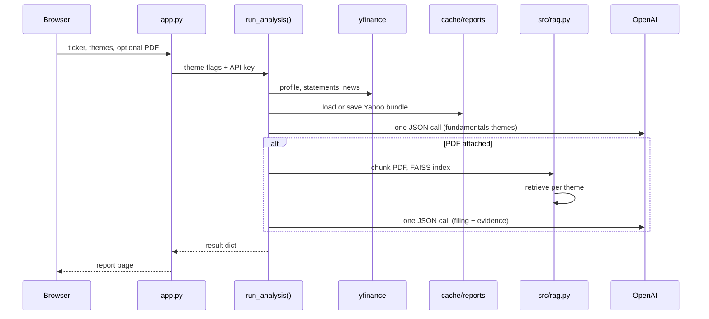

# FinAnalytica

Flask app that pulls a US ticker from Yahoo, shows the ratios and news you'd skim before a call, and—if you upload a 10-K—runs a small RAG pass so commentary isn't disconnected from what management wrote.

The point isn't "ask ChatGPT about a stock." It's: **numbers from Yahoo, narrative from the filing, and you can open the retrieved chunks** to see if the model is making things up.

## What runs when you hit Run



## Report page

- Valuation snapshot (P/E, P/B, 52-week range, etc.)
- Latest annual ratios (income, balance sheet, cash flow)
- News table + VADER sentiment on headlines
- Optional commentary (theme checkboxes)
- With a PDF: filing commentary + **retrieved passages** per theme

## Setup

Python **3.10–3.11** fits the pinned LlamaIndex / LangChain versions.

```bash
python3 -m venv .venv
source .venv/bin/activate   # Windows: .venv\Scripts\activate
pip install -r requirements.txt
export OPENAI_API_KEY=sk-...
python app.py
```

Open **http://127.0.0.1:5000** (or set `PORT`).

Optional env: `FLASK_SECRET_KEY`.

## Stack

Flask · [yfinance](https://github.com/ranaroussi/yfinance) · LangChain (prompt + `gpt-3.5-turbo`) · LlamaIndex · FAISS · pypdf · NLTK VADER

## Quick checks

1. `AAPL` without PDF — metrics and news load; commentary needs `OPENAI_API_KEY`.
2. `AAPL` + a 10-K PDF — expand retrieved passages under a risk theme; they should match the bullet text.
3. `APPL` — should resolve or warn toward `AAPL`.

## Limits

- US symbols Yahoo supports; you supply the PDF (no EDGAR download in-app).
- Bad PDF text → weak retrieval. Empty or partial JSON from the model → missing theme blocks.
- Not investment advice.

## Possible next steps (not in repo)

EDGAR by CIK, local embeddings, a tiny 3-ticker eval sheet.
